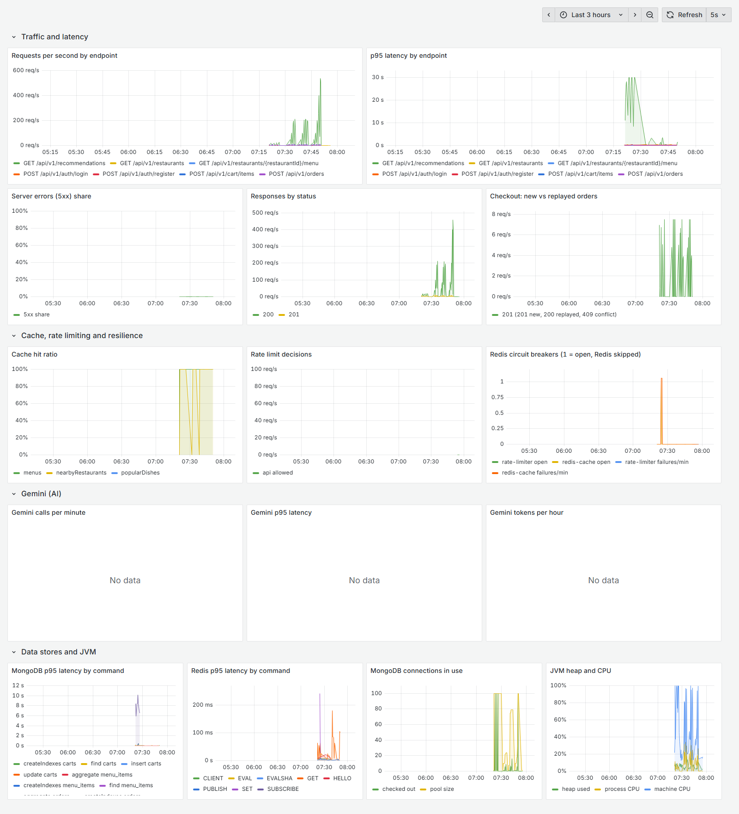

# Observability and load testing

You can't tune what you can't see. This step gives Forkcast **metrics, dashboards and distributed traces**, then
puts it under load with **k6**. The load tests found two real scalability bugs, both fixed and measured.



*The dashboard over the recommendation load runs: on the right, p95 latency at 25–30 s before the fixes, then flat;
on the left, throughput climbing to ~550 requests/s after them.*

## Running it

```bash
docker compose --profile monitoring up -d   # MongoDB, Redis + Prometheus :9090, Grafana :3000, Jaeger :16686
MANAGEMENT_OPENTELEMETRY_TRACING_EXPORT_OTLP_ENDPOINT=http://localhost:4318/v1/traces ./mvnw spring-boot:run
```

Grafana opens on the Forkcast dashboard (provisioned from `monitoring/grafana`, no login needed locally).
Jaeger shows the traces. With `docker compose --profile app --profile monitoring up -d --build`, the app runs
in a container and is already wired to both.

## Metrics: an internal management port

Actuator moved to its own port, **8081**, which is never published. Only the API port 8080 is.

| Port | Endpoint | Access |
|---|---|---|
| 8080 (public API) | `/livez`, `/readyz` | anyone (load balancer and container health checks) |
| 8080 | `/actuator/**` | doesn't exist |
| 8081 (internal) | `/actuator/health` | anyone |
| 8081 | `/actuator/prometheus` | anyone, **only on this port** |
| 8081 | `/actuator/metrics` and the rest | admin token |

Why: Prometheus scrapes without credentials, and the API's tokens expire every 60 minutes. Opening
`/actuator/prometheus` on the public port would publish internals. The security rule checks the port the request
arrived on: if someone configured management onto the API port, the endpoint would fall back to admin-only
instead of becoming public. Tested with real HTTP on both ports (`ManagementEndpointsIntegrationTest`).

What's measured, besides Spring Boot's defaults (HTTP, JVM, cache hits/misses, MongoDB pool):

| Metric | Source |
|---|---|
| `http_server_requests_seconds` (histogram) | latency per endpoint and status; p95/p99 across instances |
| `gen_ai_client_operation_seconds`, `gen_ai_client_token_usage` | every Gemini call (embeddings and chat) and its tokens, via Spring AI observations, wired by hand because the project uses Spring AI's plain libraries |
| `mongodb_driver_commands_seconds`, `lettuce_seconds` (histograms) | MongoDB and Redis latency per command |
| `forkcast_circuit_breaker_open`, `forkcast_circuit_breaker_failures` | the two Redis circuit breakers (cache, rate limiter) |
| `forkcast_rate_limit_decisions` | allowed / limited / skipped, per policy |

The dashboard is generated from `monitoring/grafana/build_dashboard.py`, where each panel is one readable line of
PromQL rather than part of 1,000 lines of JSON.

## Traces: OpenTelemetry to Jaeger

Spring Boot 4's OpenTelemetry starter plus Micrometer Tracing. Traces are sampled at 10% (configurable) and
exported over OTLP only when an endpoint is configured. Log lines carry the trace id, so a log line leads to its
trace. Three real traces:

```
POST /api/v1/orders                 69.1 ms     GET /api/v1/search/dishes            2585.7 ms
  security filter chain              2.8 ms       embedding gemini-embedding-001     2075.6 ms
  secured request                   64.5 ms       menu_items.find                       6.4 ms
    orders.find   (idempotency key)  4.3 ms       restaurants.find                      5.1 ms
    carts.find                       3.1 ms
    restaurants.find                 3.2 ms     GET /api/v1/restaurants/{id}/menu       12.5 ms
    orders.insert                    4.9 ms       (no MongoDB span: served from the Redis cache)
    carts.update                     3.4 ms
```

The search trace shows where its time goes: 80% is the Gemini call.

Getting useful traces took some work:

- **MongoDB spans:** Spring Boot instruments the MongoDB driver for metrics only. `ObservabilityConfig` adds
  Spring Data's command listener plus a context provider that carries the current trace into the driver.
- **Noise:** at first most traces were noise, with Prometheus scrapes every 5 s, health checks, the
  live-tracking heartbeat task, and Spring Security work on the management port. An `ObservationPredicate` drops
  those.
- **Redis:** Lettuce runs commands on its own I/O threads, so its spans never joined the request's trace and
  arrived as separate one-span traces. My first fix disabled those observations, which **also deleted the Redis
  latency metrics**; I noticed the panel go empty. The fix: a `SpanExportingPredicate` drops Redis spans at
  export time only, so the metrics stay.
- **A startup bug the tests caught:** an empty `${OTLP_TRACES_ENDPOINT:}` default made the OTLP exporter reject
  the empty URL, so **the app couldn't start without tracing configured**. My manual runs always set the variable.
  The fix: leave the property unset, so no exporter is created.
- The OpenTelemetry starter also pushes metrics over OTLP by default, which produced a 404 every minute against
  Jaeger. That's turned off, since Prometheus pulls metrics.

## Load tests (k6)

Three scenarios in `load-tests/`, each at a fixed arrival rate for 30 s (`load-tests/run.sh` runs the series,
`summarize.py` builds the tables):

| Scenario | What a request does |
|---|---|
| `browse` | anonymous: 50% nearby restaurants from a random point within 3 km (many cache cells), 35% menus, 15% review summaries |
| `checkout` | 200 customers add a dish and place an order; every 10th order is resent with the same Idempotency-Key |
| `recommendations` | customers with 3 orders each fetch personal recommendations |

**Setup:** one laptop (AMD Ryzen 7 7735HS, 8 cores / 16 threads, 13 GB). The app runs on Windows with JDK 21 and
virtual threads. MongoDB, Redis, the monitoring stack and k6 run in Docker on the same machine, and k6 reaches the
app through Docker Desktop's port forwarding. Rate limits are off (every request comes from one IP), and tracing
is on at 10%. So these numbers are **relative**: everything competes for the same CPU, and the client sits on it
too.

### Browse

| Target/s | Achieved/s | p50 | p95 | p99 | Errors |
|---|---|---|---|---|---|
| 100 | 100 | 12.6 ms | 43.1 ms | 404 ms (JIT warm-up) | 0% |
| 500 | 500 | 5.0 ms | 18.2 ms | 38.2 ms | 0% |
| 1,000 | 1,000 | 5.0 ms | 16.1 ms | 28.0 ms | 0.07% |
| **1,500** | **1,500** | **4.3 ms** | **14.5 ms** | **24.3 ms** | **0%** |
| 2,000 | 1,993 | 15.1 ms | 44.0 ms | 63.7 ms | 0.01% (208 iterations not started) |

**1,500 requests/s at p95 14.5 ms.** At 2,000/s the *machine* was at 100% CPU while the app process used 35%, so
the limit there is the shared laptop, not Forkcast. Cache hit ratio: **98.7%**. The JVM never had more than 62
platform threads, because requests run on virtual threads. The rare errors were k6 connections timing out inside
Docker Desktop's port forwarding; the app logged no errors.

### Checkout

Latency of placing the order (a MongoDB transaction: idempotency check, cart, restaurant, insert, cart clear):

| Target orders/s | Achieved/s | p50 | p95 | p99 | Errors |
|---|---|---|---|---|---|
| 10 | 10 | 40.4 ms | 81.3 ms | 184.8 ms | 0% |
| 50 | 50 | 31.5 ms | 43.7 ms | 60.5 ms | 0% |
| **100** | **100** | **35.0 ms** | **89.8 ms** | **139.5 ms** | **0%** |
| 200 | 179 | 187 ms | 928 ms | 1,170 ms | 0% |
| 300 | 273 | 294 ms | 562 ms | 685 ms | 0% |

**100 orders/s at p95 90 ms.** Over the whole series, **19,117 orders were created and 1,914 double-submits
replayed, with 0 duplicates and 0 errors**: idempotency and transactions held under load. The knee is between
100 and 200/s. There, all 100 MongoDB pool connections were in use with 71 requests waiting, MongoDB used ~60% CPU,
and `commitTransaction` reached p95 120 ms. The app's CPU was at 26%, so the limit is MongoDB's write path on this
machine (a single-node replica set in a Docker VM), not the app.

### Recommendations: two bottlenecks found and fixed

| Version | p95 at 100/s | p95 at 200/s | p95 at 400/s | Most it sustained |
|---|---|---|---|---|
| As built in step 12 | **39 s** | 43 s | 31 s | **~26/s** |
| + popularity only when needed, cached per area | 75 ms | 1.6 s | 3.1 s | ~200/s |
| + 32 Redis connections for vector reads (default 8) | 43 ms | 1.3 s | 3.2 s | ~200/s |
| **+ dish vectors cached in memory** | **27 ms** | **37 ms** | **78 ms** | **~560/s** |

**Bottleneck 1: a query that grows with the business.** "Popular near you" aggregated every order of the
nearby restaurants from the last 30 days, **on every request**. Right after step 12 the database held ~10 orders,
so it took milliseconds. After the checkout test it held 19,789, so it took 8.5 s (p95 of `orders.aggregate`), and
requests queued for MongoDB connections (400 waiting) while the app's CPU idled at 23%. The fix: compute it only
when personal matches don't fill the list, which is rare for customers with a history, and cache it per area
for 10 minutes, because popularity over 30 days barely moves in 10 minutes. At larger scale it would be
precomputed (a scheduled `$merge` into a popularity collection).

**Bottleneck 2: Redis' single command thread.** Next, the ceiling sat at ~200/s with MongoDB fast and the app at
40% CPU. A bigger connection pool helped latency a little, but not the ceiling. `docker stats` showed Redis at
~100% CPU, which is one core, its limit, since Redis runs commands on one thread. `INFO commandstats` named
the cause: `JSON.MGET` at **1.14 ms of Redis CPU per call**, serializing 768-float vectors to JSON text, twice per
recommendation (the taste seeds, then the explanations). Dish vectors only change when a dish is re-indexed, so
they're now cached in memory (Caffeine, bounded, invalidated by the indexer, 10-minute expiry for other
instances). `JSON.MGET` calls over a full test series went from **89,929 to 22**. What's left per request is one
KNN search, at 0.6 ms of Redis CPU.

## What I'd do next

- Precompute popularity with a scheduled aggregation instead of caching the live one.
- Instrument the Jedis client used for vector search; it's the one remaining gap in traces.
- Run the load tests against a deployed environment (app, database and load generator on separate machines) for
  absolute numbers.
- Alerts in Prometheus or Grafana, e.g. p95 above an SLO, 5xx share above 1%, a circuit breaker open for more
  than a minute.
